<div align="center">

# Amplificador de instrumentación y rechazo de modo común
### Amplificador de tres op-amps con TL084N (Ad = 21) para biopotenciales y medición del CMRR ante interferencia de red de 60 Hz

**Laboratorio N.º 3 · Instrumentación Biomédica III**<br>
Escuela Profesional de Ingeniería Biomédica · Facultad de Ingeniería Electrónica y Eléctrica<br>
**Universidad Nacional Mayor de San Marcos**

-CC0000)


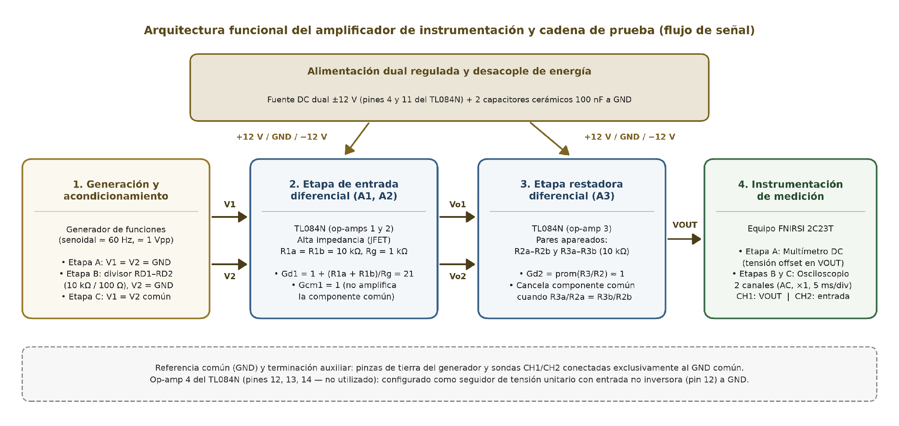

<sub>Diagrama de bloques: generador (60 Hz) → etapa de entrada diferencial A1–A2 (Gd1 = 21) → restador A3 (Gd2 = 1) → medición con FNIRSI 2C23T, con alimentación dual de ±12 V y desacople.</sub>

</div>

---

## Contenido

- [Descripción](#descripción)
- [Resultados en un vistazo](#resultados-en-un-vistazo)
- [Fundamento teórico](#fundamento-teórico)
- [Estructura del repositorio](#estructura-del-repositorio)
- [Archivos de soporte (Tabla 7)](#archivos-de-soporte-tabla-7)
- [Materiales y equipos](#materiales-y-equipos)
- [Esquemáticos](#esquemáticos)
- [Cómo reproducir el experimento](#cómo-reproducir-el-experimento)
- [Resultados](#resultados)
- [Evidencia fotográfica](#evidencia-fotográfica)
- [Conclusiones](#conclusiones)
- [Referencias](#referencias)
- [Integrantes](#integrantes)

---

## Descripción

En los laboratorios anteriores se construyó una cadena de acondicionamiento para un electrodo de pH simulado: un **buffer de alta impedancia** ([Laboratorio N.º 1](https://github.com/AxwellMz/lab1-acondicionamiento-alta-impedancia)) y una **etapa de ganancia con calibración** ([Laboratorio N.º 2](https://github.com/AxwellMz/lab2-etapa-ganancia-calibracion)). Ambas trabajan con una sola entrada referida a tierra.

Un **biopotencial** (ECG, EMG, EEG) es distinto: se mide como la **diferencia** entre dos electrodos, tiene amplitudes de microvoltios a pocos milivoltios y llega acompañado por la **interferencia de la red de 60 Hz**, que aparece casi igual en ambos electrodos y puede ser cientos de veces mayor. Para separarlos se necesita un **amplificador de instrumentación**.

En este laboratorio se armó un amplificador de instrumentación clásico de **tres op-amps** con un solo TL084N y se comprobaron sus dos comportamientos:

1. **Etapa A — Montaje y verificación.** Se midieron y **aparearon** las nueve resistencias, se armó el circuito a ±12 V y se verificó en reposo (V1 = V2 = GND) que la salida no estuviera saturada: **VOUT = −7 mV**.
2. **Etapa B — Señal diferencial.** Con un divisor RD1–RD2 se aplicó una senoidal de **≈ 10 mVpp a 60 Hz** (del orden de un biopotencial): la salida fue **0.21 Vpp, en fase** → **Ad = 21.0**.
3. **Etapa C — Señal de modo común.** Se aplicó **1.05 Vpp** a ambas entradas a la vez (como la interferencia de red): la salida quedó **por debajo del piso de ruido** del osciloscopio (< 0.01 Vpp) → **CMRR > 66.87 dB**.

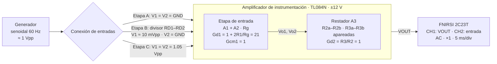

---

## Resultados en un vistazo

<div align="center">

| Indicador | Criterio / referencia | Resultado | Estado |
|---|:--:|:--:|:--:|
| Offset en reposo (Etapa A) | \|VOUT\| < 1 V | **−0.007 V** (7 mV) | ✅ Sin saturación |
| Ganancia diferencial teórica | Valores medidos (Tabla 1) | **21.0054** | — |
| Ganancia diferencial medida (Etapa B) | 21 | **21.0** (error 0.03 %) · 22.0 en la 2.ª captura | ✅ Cumple |
| Fase VOUT vs. V1 | En fase | **Δφ ≈ 0°** | ✅ |
| Ganancia de modo común (Etapa C) | — | **Acm < 9.52 × 10⁻³** | ✅ Rechazo |
| CMRR experimental | — | **> 66.87 dB** (cota inferior) | ✅ |
| CMRR limitado por el desajuste resistivo | Modelo | **≈ 92.29 dB** | — |

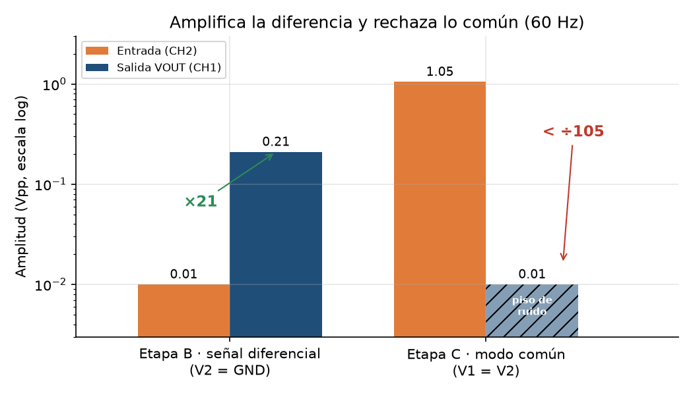

<sub>Una señal 105 veces mayor en modo común (Etapa C) produce una salida al menos 21 veces menor que la señal diferencial de 10 mVpp (Etapa B).</sub>

</div>

---

## Fundamento teórico

**Descomposición de las entradas** en señal diferencial (biopotencial) y de modo común (interferencia):

$$V_d = V_1 - V_2, \qquad V_{cm} = \frac{V_1 + V_2}{2}, \qquad V_{OUT} = A_d\,V_d + A_{cm}\,V_{cm}$$

**Primera etapa (A1, A2).** La corriente $I = V_d/R_g$ circula por R1a, Rg y R1b; la señal común no genera corriente en Rg y pasa con ganancia unitaria:

$$G_{d1} = 1 + \frac{R_{1a} + R_{1b}}{R_g} = 1 + \frac{9.77\ \text{k}\Omega + 9.77\ \text{k}\Omega}{977\ \Omega} = 21.0000, \qquad G_{cm1} = 1$$

**Segunda etapa (A3, restador).** Con $p = R_{3a}/R_{2a}$ y $q = R_{3b}/R_{2b}$:

$$V_{OUT} = \frac{(1+q)\,p}{1+p}\,V_{o1} - q\,V_{o2} \quad\Rightarrow\quad A_d = \frac{G_{d1}}{2}\left[\frac{(1+q)\,p}{1+p} + q\right], \qquad A_{cm} = \frac{p - q}{1 + p}$$

Con $p = 9800/9790 = 1.001021$ y $q = 9800/9800 = 1.000000$: $A_d = 21.0054$ y $A_{cm} = 5.105 \times 10^{-4}$.

**Razón de rechazo de modo común:**

$$\text{CMRR (dB)} = 20\,\log_{10}\!\left(\frac{A_d}{A_{cm}}\right)$$

> Si $R_{3a}/R_{2a} = R_{3b}/R_{2b}$ la componente común se cancela por completo. Por eso se **aparean** R2a–R2b y R3a–R3b, y la ganancia se concentra en la primera etapa: así la señal diferencial llega al restador amplificada 21 veces y la común no, lo que multiplica el CMRR global por 21.

---

## Estructura del repositorio

```
lab3-amplificador-instrumentacion-cmrr/
├── hardware/
│   ├── proteus/                      ← proyectos .pdsprj de las Etapas A, B y C (Proteus 8)
│   ├── esquematicos/                 ← capturas PNG de los tres esquemáticos
│   └── README.md                     ← pines del TL084N y conexión de entradas por etapa
├── data/                             ← Tablas 1 a 4 del informe en CSV + resultados generados
├── analysis/
│   ├── analisis_cmrr.py              ← Ad, Acm, CMRR, peor caso y figuras
│   └── calculo_cmrr.xlsx             ← la misma hoja de cálculo con fórmulas editables
├── docs/
│   ├── galeria.md                    ← las 12 figuras del informe con leyenda
│   └── img/                          ← fotos por etapa, capturas del osciloscopio y resultados
├── LICENSE
└── README.md
```

---

## Archivos de soporte (Tabla 7)

Registro de los archivos de soporte del informe, tal como se solicita en la **Tabla 7** (sección 8, Materiales y código).

| Archivo / módulo | Descripción breve | Plataforma | Enlace al repositorio |
|---|---|:--:|---|
| Esquemático eléctrico (Proteus) | Esquema completo del amplificador de instrumentación con pines TL084N y desacople, uno por etapa | GitHub · Proteus 8 | [`hardware/`](hardware/) |
| Capturas del osciloscopio-multímetro y fotografías | Evidencias originales de las Etapas A, B y C (FNIRSI 2C23T y montaje) | GitHub | [`docs/galeria.md`](docs/galeria.md) · [`docs/img/`](docs/img/) |
| Hoja de cálculo / script de análisis | Cálculo de Ad, Acm, CMRR y comparación con los valores medidos de la Tabla 1 | GitHub · Python / Excel | [`analysis/`](analysis/) · [`data/`](data/) |
| Fotos y videos adicionales del sistema en funcionamiento | Montaje en protoboard, mediciones de resistencias y conexiones de cada etapa | GitHub | [`docs/galeria.md`](docs/galeria.md) |

---

## Materiales y equipos

| Componente / equipo | Cant. | Marca / modelo u observación |
|---|:--:|---|
| Amplificador operacional cuádruple | 1 | TL084N, DIP-14, entrada JFET |
| Resistencias de 10 kΩ | 7 | Axiales, cuatro bandas, ±5 % (R1a, R1b, R2a, R2b, R3a, R3b, RD1) |
| Resistencia de 1 kΩ (Rg) | 1 | Axial, cuatro bandas, ±5 % |
| Resistencia de 100 Ω (RD2) | 1 | Axial, cuatro bandas, ±5 % |
| Capacitor cerámico de 100 nF | 2 | Desacople de +12 V y −12 V a GND |
| Protoboard | 1 | 830 puntos |
| Cable BNC–caimán y jumpers macho–macho | 1 / ≈ 20 | Interconexión de etapas y alimentación |
| Osciloscopio y multímetro portátil | 1 | FNIRSI 2C23T (2 canales, sondas P2220 en ×1, AC) |
| Multímetro digital (resistencias) | 1 | UNI-T UT33B+ |
| Fuente DC dual (tracking ±12 V) | 1 | SIGLENT SPD3303DC |
| Generador de funciones | 1 | BK PRECISION 4012A (60 Hz, ≈ 1 Vpp) |

---

## Esquemáticos

<table>
<tr>
<td align="center" width="33%">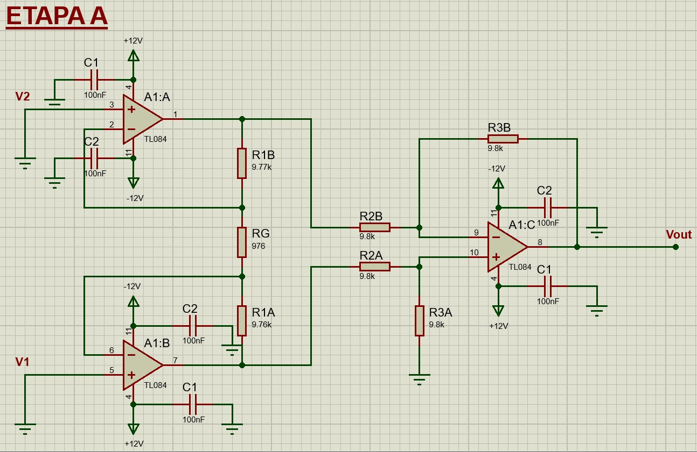<br><sub><b>Etapa A</b> · Reposo: V1 = V2 = GND, ±12 V y desacople de 100 nF.</sub></td>
<td align="center" width="33%">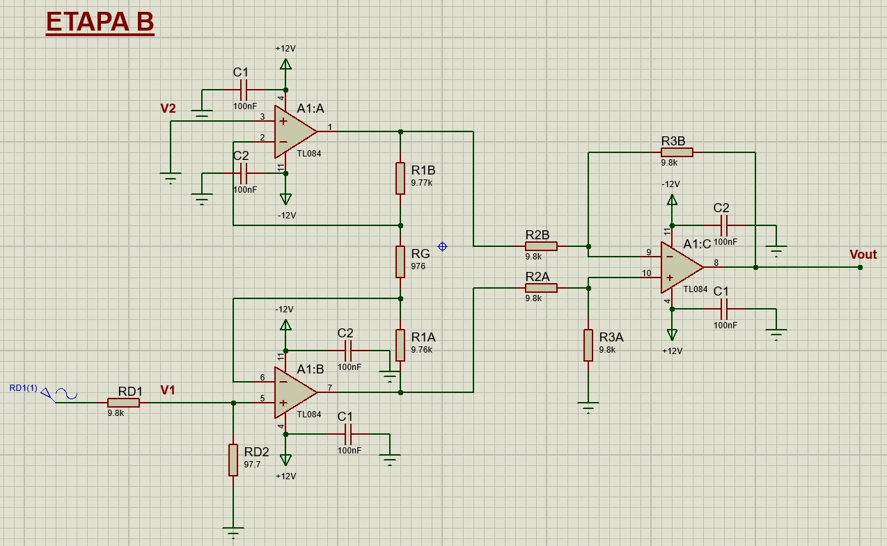<br><sub><b>Etapa B</b> · Divisor RD1–RD2 en V1 (≈ 10 mVpp) y V2 = GND.</sub></td>
<td align="center" width="33%">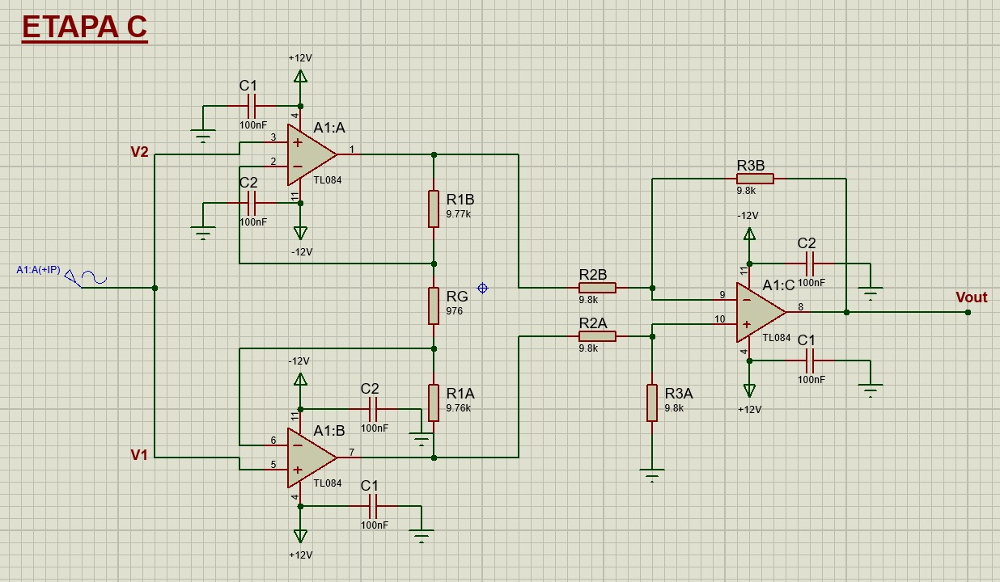<br><sub><b>Etapa C</b> · V1 y V2 unidas al generador (modo común).</sub></td>
</tr>
</table>

Pines del TL084N, conexión de entradas por etapa y diseño de la ganancia: [`hardware/README.md`](hardware/README.md).

---

## Cómo reproducir el experimento

<details open>
<summary><b>Etapa A — Montaje y verificación</b></summary>

1. Medir las nueve resistencias. Entre las siete de 10 kΩ, asignar a **R2a–R2b** el par más parecido y a **R3a–R3b** el siguiente; las tres restantes son R1a, R1b y RD1.
2. Configurar la fuente en modo dual a **±12 V** (apagada). Alimentar el TL084N: **pin 4 → +12 V**, **pin 11 → −12 V**, con un capacitor de **100 nF** de cada pin a GND, junto al integrado.
3. Etapa de entrada: V1 en **pin 3** y V2 en **pin 5**; **R1a** entre 1 y 2, **R1b** entre 7 y 6, **Rg** entre 2 y 6.
4. Restador: **R2a** (1 → 10), **R3a** (10 → GND), **R2b** (7 → 9), **R3b** (9 → 8). El **pin 8** es **VOUT**.
5. Op-amp 4 sin usar como seguidor: pin 12 a GND y pines 13–14 unidos.
6. Con **V1 = V2 = GND**, encender la fuente y medir VOUT en VDC: debe ser **< 1 V** (aquí, −7 mV).
</details>

<details>
<summary><b>Etapa B — Respuesta a una señal diferencial</b></summary>

1. Retirar V1 de GND (V2 sigue a GND). Generador: senoidal de **60 Hz, 1 Vpp**, sin offset, carga **High Z**.
2. **RD1 = 10 kΩ** en serie entre el generador y V1; **RD2 = 100 Ω** entre V1 y GND (atenuación ≈ 1/101).
3. Osciloscopio en **AC, ×1, 5 ms/div**. En este montaje: **CH1 = VOUT** (100 mV/div) y **CH2 = V1** (20 mV/div), para un disparo estable sobre la señal mayor.
4. Medir Vpp de V1 y VOUT, verificar la fase y guardar la captura. **Ad = VOUT / V1**.
</details>

<details>
<summary><b>Etapa C — Respuesta a una señal de modo común</b></summary>

1. Desconectar el generador; retirar RD1, RD2 y el puente de V2 a GND.
2. Unir **V1 con V2** y conectar el generador a ese nodo (misma señal: 60 Hz, 1 Vpp).
3. **CH2 = V1 = V2** (500 mV/div) y **CH1 = VOUT** en su escala más sensible (20 mV/div en el FNIRSI 2C23T).
4. Medir Vpp. Si VOUT no se distingue del ruido, anotar la amplitud del ruido: **VOUT real < ruido**.
</details>

<details>
<summary><b>Análisis de datos</b></summary>

```bash
pip install pandas numpy matplotlib
python analysis/analisis_cmrr.py
```

Salida esperada:

```
[Etapa A] VOUT = -7 mV DC -> CUMPLE (|VOUT| < 1 V)
[Modelo ] Gd1 = 21.0000 | p = 1.001021 | q = 1.000000 | Ad = 21.0054 | Ad(V2=0) = 21.0056
[Etapa B] Captura 1: 0.21/0.01 -> Ad = 21.0 | error = 0.03 %
[Etapa B] Captura 2: 0.22/0.01 -> Ad = 22.0 | error = 4.74 %
[Etapa B] Divisor medido: V1 = 10.333 mVpp -> VOUT esperado = 0.2171 Vpp
[Etapa C] Acm < 0.009524 -> CMRR > 66.87 dB (limitado por el piso de ruido de 10 mVpp)
[Modelo ] Acm = 0.0005105 | fuga = 0.536 mVpp | CMRR = 92.29 dB
[Global ] CMRR estimado: 82.57 dB (TL084 típ.) | 69.36 dB (TL084 mín.)
[Peor c.] ±5 %: Acm = 0.1053, CMRR = 46.00 dB | ±1 %: Acm = 0.0202, CMRR = 60.34 dB
```

Genera `data/resultados_resumen.csv`, `data/peor_caso_tolerancia.csv` y las figuras de `docs/img/resultados/`. Sin Python, los mismos cálculos están en [`analysis/calculo_cmrr.xlsx`](analysis/calculo_cmrr.xlsx): al cambiar las celdas amarillas (mediciones) se recalculan las verdes (resultados).
</details>

---

## Resultados

### Tabla 1 — Resistencias medidas y apareamiento

| Resistencia | R1a | R1b | Rg | R2a | R2b | R3a | R3b | RD1 | RD2 |
|---|:--:|:--:|:--:|:--:|:--:|:--:|:--:|:--:|:--:|
| **Nominal** | 10 kΩ | 10 kΩ | 1 kΩ | 10 kΩ | 10 kΩ | 10 kΩ | 10 kΩ | 10 kΩ | 100 Ω |
| **Medido** | 9.77 kΩ | 9.77 kΩ | 977 Ω | 9.79 kΩ | 9.80 kΩ | 9.80 kΩ | 9.80 kΩ | 9.84 kΩ | 97.8 Ω |

Los pares del restador quedaron casi idénticos: $R_{3a}/R_{2a} = 1.001021$ y $R_{3b}/R_{2b} = 1.000000$ (discrepancia de solo **0.1021 %**).

<p align="center">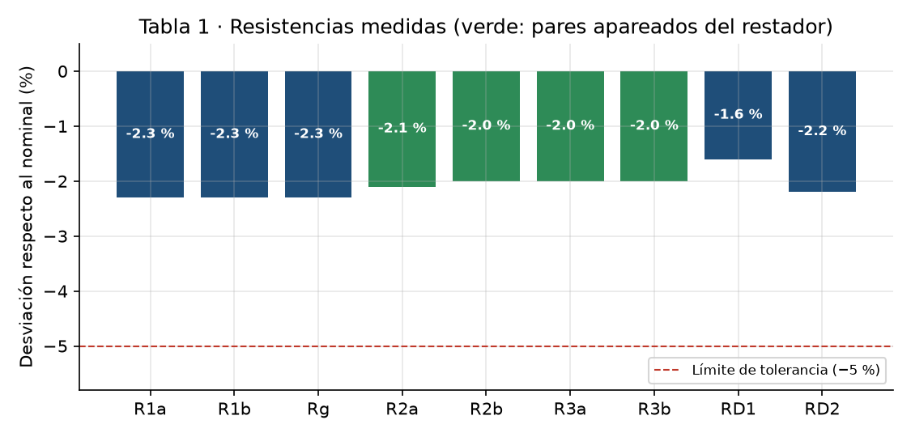</p>

### Etapa A — Verificación en reposo (Tabla 2)

| Medición | Valor |
|---|:--:|
| Tensión continua en VOUT (V1 = V2 = GND) | **−0.007 V** (\|VOUT\| = 7 mV < 1 V, sin saturación) |

### Etapa B — Señal diferencial (Tabla 3)

| Captura | V1 (Vpp) | VOUT (Vpp) | f (Hz) | Ad medida | ¿En fase? |
|:--:|:--:|:--:|:--:|:--:|:--:|
| 1 | 0.01 | **0.21** | 60.24 | **21.0** | Sí (Δφ ≈ 0°) |
| 2 | 0.01 | **0.22** | 60.24 | 22.0 | Sí |

La diferencia entre capturas se debe a la resolución de 0.01 V del FNIRSI 2C23T. Con el divisor medido, V1 real ≈ **10.333 mVpp** y la salida esperada es 10.333 mV × 21.0056 ≈ **0.2171 Vpp**, justo entre las dos lecturas.

### Etapa C — Señal de modo común (Tabla 4)

| V1 = V2 (Vpp) | f (Hz) | VOUT (Vpp) | ¿VOUT se distinguió del ruido? |
|:--:|:--:|:--:|:--:|
| **1.05** | 60.98 | **0.01** (piso de ruido; VOUT real < 0.01 Vpp) | No |

### Tabla 5 — Ganancias y CMRR

| Magnitud | Cálculo | Resultado |
|---|---|:--:|
| Ganancia diferencial teórica | Gd1 = 21.0000; Ad = (Gd1/2)·[(1+q)p/(1+p) + q] | **21.0054** (efectiva con V2 = 0: 21.0056) |
| Ganancia diferencial medida | 0.21 / 0.01 · 0.22 / 0.01 | **21.0 – 22.0** |
| Ganancia de modo común | Acm,exp < 0.01 / 1.05 · Acm,teo = (p − q)/(1 + p) | **< 0.00952** · modelo 0.0005105 |
| CMRR | 20·log10(21.0 / 0.009524) · 20·log10(21.0054 / 0.0005105) | **> 66.87 dB** · modelo ≈ 92.29 dB |

<table>
<tr>
<td align="center" width="50%">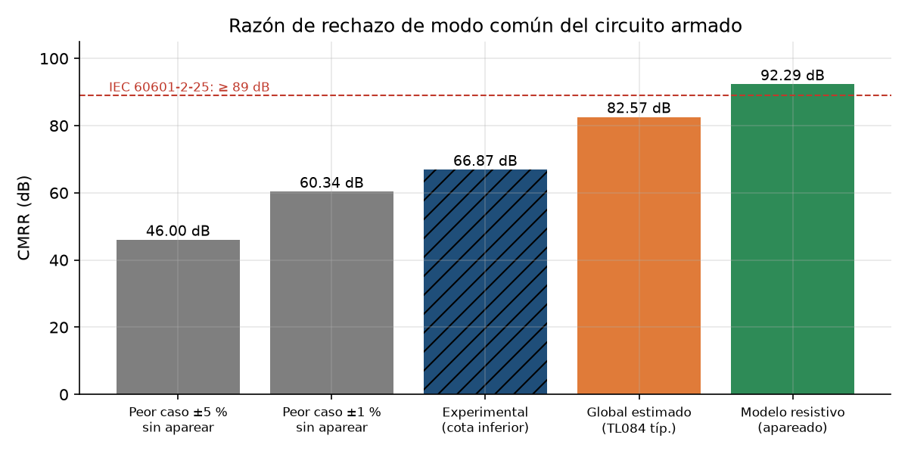<br><sub>CMRR experimental (cota inferior), estimado y de peor caso, frente al mínimo de la IEC 60601-2-25 para electrocardiógrafos.</sub></td>
<td align="center" width="50%">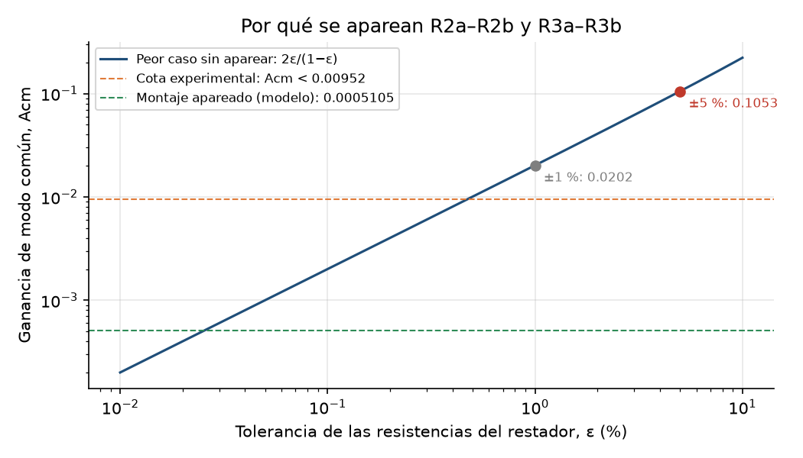<br><sub>Sin aparear, resistencias de ±5 % darían Acm ≈ 0.1053 (CMRR ≈ 46 dB); el apareamiento baja el modelo a 0.0005105.</sub></td>
</tr>
</table>

**¿Por qué solo una cota?** La fuga real que predice el modelo ante 1.05 Vpp es de apenas **0.536 mVpp**, muy por debajo de la resolución de 10 mV del osciloscopio portátil. Por eso solo puede afirmarse **CMRR > 66.87 dB**; el límite viene del instrumento, no del circuito.

---

## Evidencia fotográfica

<table>
<tr>
<td align="center" width="33%">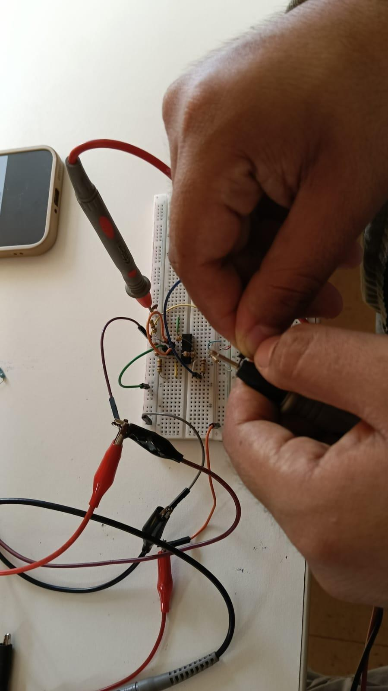<br><sub><b>Etapa A</b> · Montaje en protoboard y medición de VOUT en reposo.</sub></td>
<td align="center" width="33%">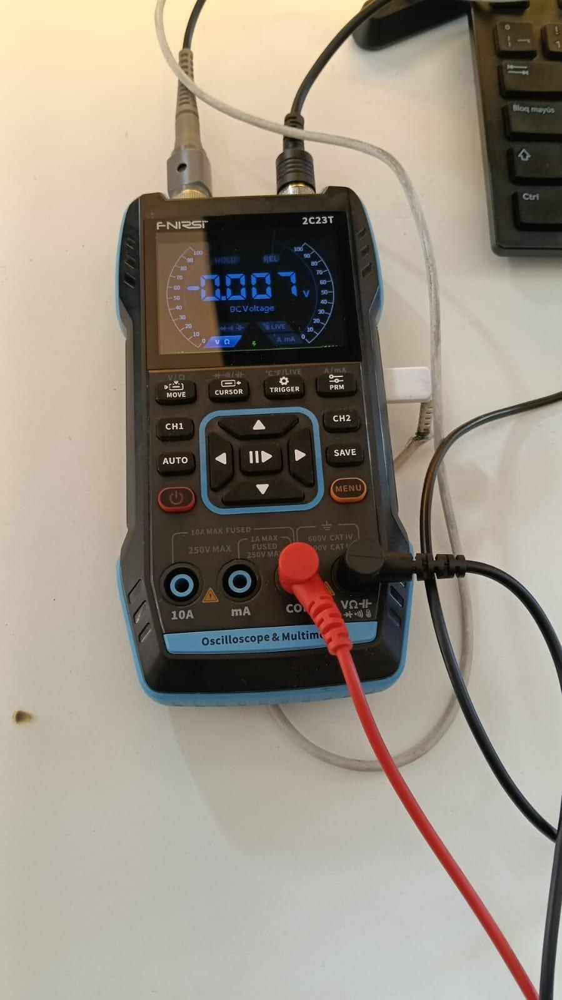<br><sub><b>Etapa A</b> · VOUT = −0.007 V DC.</sub></td>
<td align="center" width="33%">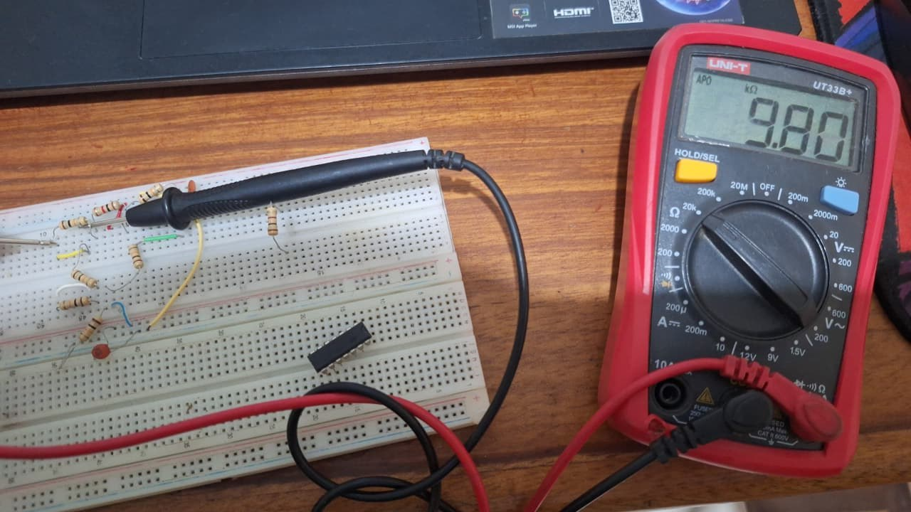<br><sub><b>Etapa A</b> · Apareamiento: R2b = 9.80 kΩ.</sub></td>
</tr>
<tr>
<td align="center">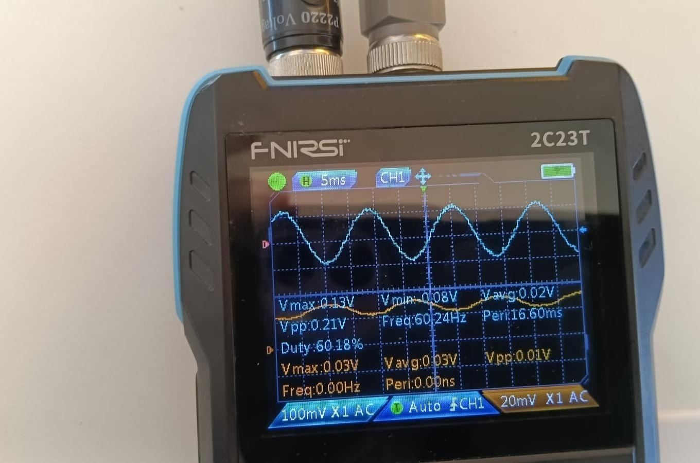<br><sub><b>Etapa B</b> · VOUT = 0.21 Vpp (azul) y V1 = 0.01 Vpp (amarillo), en fase.</sub></td>
<td align="center">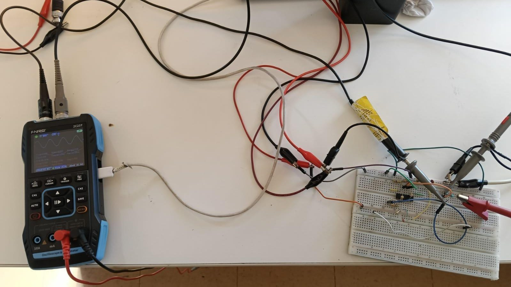<br><sub><b>Etapa B</b> · Divisor RD1–RD2 y sondas CH1/CH2.</sub></td>
<td align="center">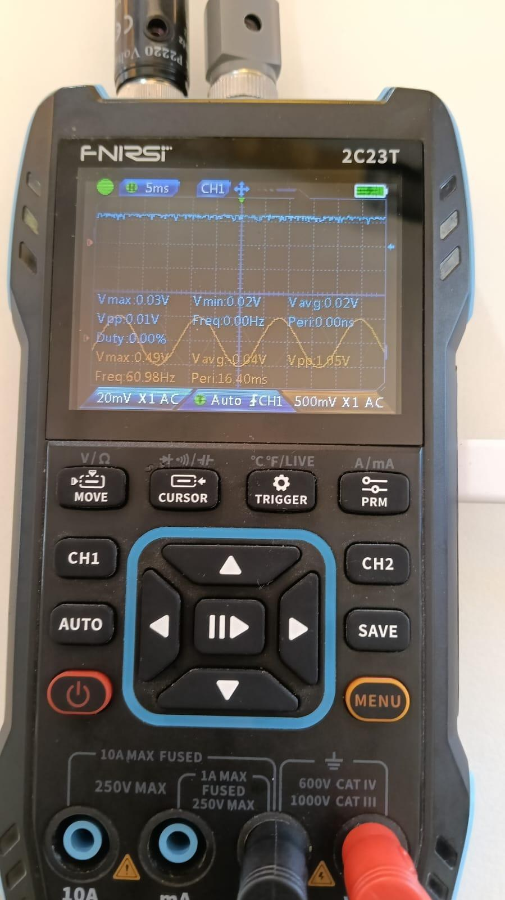<br><sub><b>Etapa C</b> · Vcm = 1.05 Vpp (amarillo) y VOUT plano (azul).</sub></td>
</tr>
</table>

**Galería completa (diagrama de bloques, 8 mediciones de resistencias, 3 esquemáticos, montajes y capturas de cada etapa, con leyenda):** [`docs/galeria.md`](docs/galeria.md)

---

## Conclusiones

- **Estabilidad DC (Etapa A).** El amplificador de tres op-amps con TL084N, ±12 V y desacople de 100 nF quedó correctamente armado: en reposo, la salida residual fue de **−7 mV**, sin saturación.
- **Amplificación diferencial (Etapa B).** Ante 0.01 Vpp a 60.24 Hz, la salida fue **0.21 Vpp en fase** (con una fluctuación a 0.22 Vpp por resolución). La ganancia medida (**21.0**) coincide con la teórica calculada con las resistencias medidas (**21.0054**), con un error de **0.03 %**.
- **Rechazo de modo común (Etapa C).** Con 1.05 Vpp en ambas entradas, VOUT no superó el piso de ruido de 0.01 Vpp: **Acm < 0.00952** y **CMRR > 66.87 dB**. El modelo del desajuste resistivo predice una fuga de solo 0.536 mVpp (≈ 92.29 dB).
- **Importancia del apareamiento.** Las razones R3a/R2a y R3b/R2b difieren solo 0.1021 %. Sin aparear, resistencias de ±5 % podrían dar Acm ≈ 0.1053 y un CMRR de apenas **46.00 dB**.
- **Aplicación biomédica.** Concentrar la ganancia en la primera etapa y aparear el restador permite extraer señales milivólticas mientras se atenúa la interferencia de 60 Hz. Para alcanzar el CMRR ≥ 89 dB que exige la IEC 60601-2-25 en electrocardiógrafos, conviene usar integrados como el **INA128** o el **AD620** y un circuito de **pierna derecha (DRL)**.

---

## Referencias

1. Analog Devices. (2011). *AD620: Low cost, low power instrumentation amplifier* [Hoja de datos, Rev. H]. https://www.analog.com/media/en/technical-documentation/data-sheets/AD620.pdf
2. Franco, S. (2015). *Design with operational amplifiers and analog integrated circuits* (4.ª ed.). McGraw-Hill Education.
3. Huhta, J. C., & Webster, J. G. (1973). 60-Hz interference in electrocardiography. *IEEE Transactions on Biomedical Engineering, BME-20*(2), 91–101. https://doi.org/10.1109/TBME.1973.324169
4. International Electrotechnical Commission. (2011). *Medical electrical equipment — Part 2-25: Particular requirements for the basic safety and essential performance of electrocardiographs* (IEC 60601-2-25:2011).
5. Texas Instruments. (2015). *INA128x, INA129x precision, low-power instrumentation amplifiers* [Hoja de datos, SBOS051]. https://www.ti.com/lit/ds/symlink/ina128.pdf
6. Texas Instruments. (2021). *TL08xx JFET-input operational amplifiers* [Hoja de datos, SLOS081]. https://www.ti.com/lit/ds/symlink/tl084.pdf
7. Webster, J. G., & Nimunkar, A. J. (2020). *Medical instrumentation: Application and design* (5.ª ed.). John Wiley & Sons.
8. Winter, B. B., & Webster, J. G. (1983). Driven-right-leg circuit design. *IEEE Transactions on Biomedical Engineering, BME-30*(1), 62–66. https://doi.org/10.1109/TBME.1983.325168

---

## Integrantes

**L12** · Docente: **PhD. María Elisia Armas Alvarado** · Fecha: 7 de noviembre de 2026 (completado en la sesión de la semana siguiente)

| N.º | Integrante | Código |
|:--:|---|:--:|
| 1 | Fernández Cuevas, Jesús Alberto | 23190372 |
| 2 | Aguilar Anamaria, Samuel Alessandro | 23190362 |
| 3 | Pantoja Iturrizaga, Diego Felipe | 23190127 |
| 4 | Mora Zeña, Axel Tadeo Uriel | 23190381 |
| 5 | Laurente Caldas, Gabriel Alexander | 23190376 |

<div align="center"><sub>UNMSM · Instrumentación Biomédica III · 2026 · Licencia MIT · <a href="https://github.com/AxwellMz/lab1-acondicionamiento-alta-impedancia">Laboratorio N.º 1</a> · <a href="https://github.com/AxwellMz/lab2-etapa-ganancia-calibracion">← Laboratorio N.º 2</a></sub></div>
