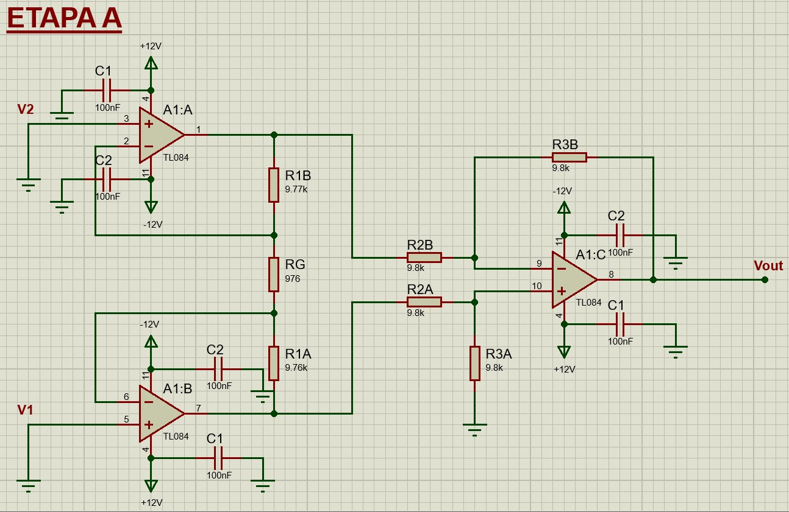
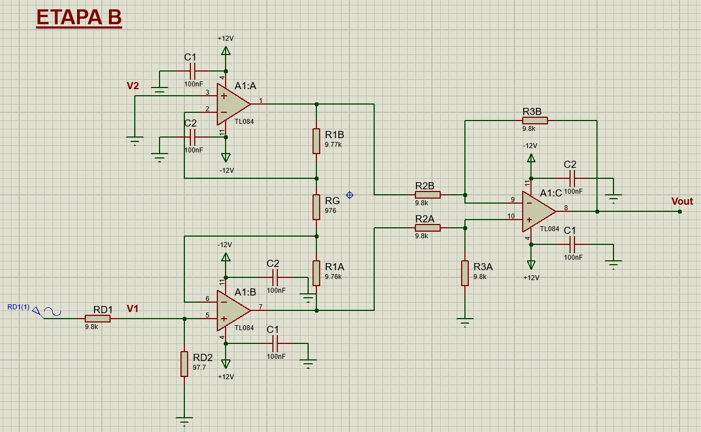
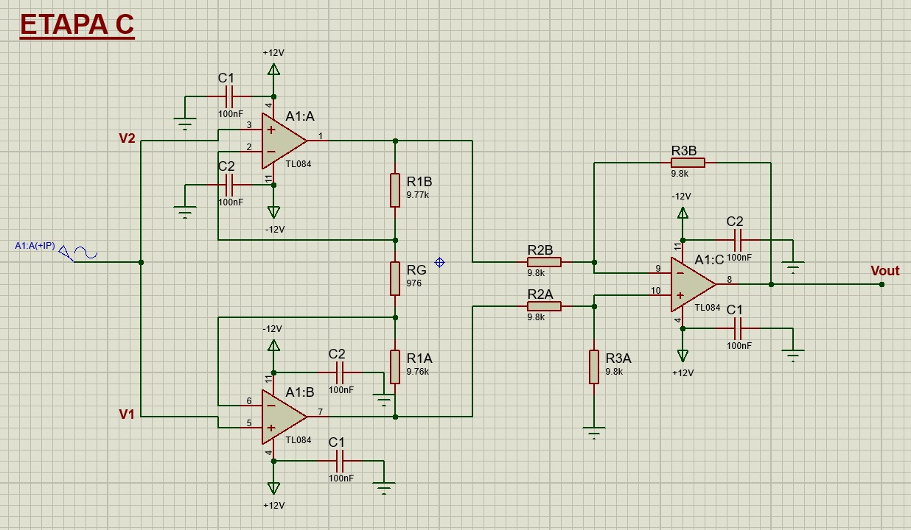

# Hardware — Esquemáticos y proyectos Proteus

Los archivos `.pdsprj` se abren con **Proteus 8 Professional** (Labcenter Electronics). Hay un proyecto por etapa, porque entre las etapas solo cambia la forma de conectar las entradas V1 y V2.

| Archivo | Etapa | Contenido |
|---|---|---|
| `proteus/Labo_3-EtapaA_Montaje_Reposo.pdsprj` | Etapa A | Amplificador de instrumentación con TL084 (A1:A, A1:B y A1:C), ±12 V y desacople de 100 nF; **V1 = V2 = GND**. |
| `proteus/Labo_3-EtapaB_Senal_Diferencial.pdsprj` | Etapa B | Mismo circuito + divisor **RD1–RD2** en V1 (generador senoidal); **V2 = GND**. |
| `proteus/Labo_3-EtapaC_Modo_Comun.pdsprj` | Etapa C | Mismo circuito con **V1 y V2 unidas** y conectadas directamente al generador (señal de modo común). |

## Vista previa

| Etapa A — Reposo | Etapa B — Señal diferencial | Etapa C — Modo común |
|:--:|:--:|:--:|
|  |  |  |

> En los esquemáticos, las etiquetas de las resistencias son aproximaciones de los valores medidos (p. ej., RG = 976 Ω, R1A = 9.76 kΩ). Los valores de referencia para todos los cálculos son los de la **Tabla 1** ([`data/tabla1_resistencias.csv`](../data/tabla1_resistencias.csv)).

## Conexiones del TL084N (DIP-14)

| Bloque / función | Op-amp | IN+ | IN− | Salida | Conexión en el circuito |
|---|:--:|:--:|:--:|:--:|---|
| Etapa de entrada (V1) | A1 (op-amp 1) | 3 | 2 | 1 | V1 en pin 3; R1a entre 1 y 2; Rg entre 2 y 6 |
| Etapa de entrada (V2) | A2 (op-amp 2) | 5 | 6 | 7 | V2 en pin 5; R1b entre 7 y 6; Rg entre 2 y 6 |
| Restador diferencial | A3 (op-amp 3) | 10 | 9 | 8 | R2a (1–10), R3a (10–GND), R2b (7–9), R3b (9–8 = **VOUT**) |
| Seguidor auxiliar | Op-amp 4 | 12 | 13 | 14 | Pin 12 a GND; pines 13 y 14 puenteados (no usado) |
| Alimentación ±12 V | Común | Pin 4 (+12 V) | Pin 11 (−12 V) | — | Capacitor cerámico de 100 nF de cada pin a GND |

## Conexión de entradas por etapa

| Etapa | V1 | V2 | Generador (60 Hz, ≈ 1 Vpp) |
|---|---|---|---|
| A | GND | GND | Desconectado |
| B | Nodo del divisor: RD1 (10 kΩ) en serie desde el generador, RD2 (100 Ω) a GND | GND | A través de RD1 |
| C | Unida a V2 | Unida a V1 | Directo al nodo común V1 = V2 |

La pinza de tierra del generador y las de las sondas CH1/CH2 se conectan **solo al GND común** (terminal COM de la fuente dual).

## Diseño de la ganancia

```
Ad = [1 + (R1a + R1b)/Rg] · (R3/R2) = [1 + 20 kΩ/1 kΩ] · (10 kΩ/10 kΩ) = 21   (+26.44 dB)
```

Toda la ganancia se concentra en la primera etapa (A1–A2) y el restador (A3) trabaja con ganancia unitaria: así la señal diferencial se amplifica 21 veces antes del restador mientras la de modo común pasa con ganancia 1, lo que multiplica el CMRR global por 21.
